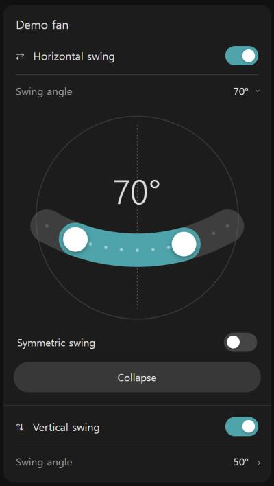
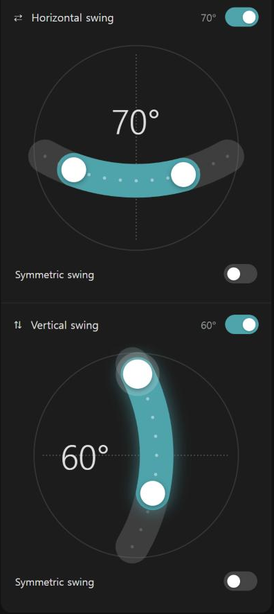

<h1 align="center">Fan Angle Card</h1>

<p align="center">
  Home Assistant에서 선풍기·서큘레이터의 회전 범위를 <b>호(arc) 슬라이더 하나와 핸들 두 개</b>로 설정합니다.<br>
  샤오미 Home 앱과 같은 방식입니다.
</p>

<p align="center">
  <a href="https://github.com/StellarSea/ha-fan-angle-card/releases"></a>
  <a href="https://hacs.xyz/docs/faq/custom_repositories"></a>
  <a href="LICENSE"></a>
</p>

<p align="center">
  <a href="README.md">English</a> · <b>한국어</b>
</p>

<p align="center">
  
  &nbsp;&nbsp;
  
</p>

---

## 목차

- [이 카드가 필요한 이유](#이-카드가-필요한-이유)
- [기능](#기능)
- [설치](#설치)
- [빠른 시작](#빠른-시작)
- [설정](#설정)
- [사용법](#사용법)
- [값을 쓰는 방식](#값을-쓰는-방식)
- [테마](#테마)
- [문제 해결](#문제-해결)
- [개발](#개발)

## 이 카드가 필요한 이유

일부 선풍기 통합은 회전 범위를 **경계값 엔티티 여러 개**로 따로 제공합니다. 예를 들어 `xiaomi_miot`은 샤오미/미지아 서큘레이터(`xiaomi.fan.p90`)에 대해 다음 네 개를 만듭니다.

```
number.fan_left_angle    10–120
number.fan_right_angle    0–110
number.fan_up_angle      10–100
number.fan_down_angle     0–90
```

서로 영향을 주는 숫자 슬라이더 두 개를 따로 조절하는 건 불편합니다.

- 실제 회전 범위가 안 보이고 숫자 두 개만 보입니다.
- 왼쪽 경계가 오른쪽 경계보다 작거나 같은 것처럼 잘못된 조합을 고르기 쉽습니다.
- 많은 기기가 범위를 무효로 만드는 쓰기를 **오류 없이 무시**합니다. 값을 하나 바꿨는데 아무 일도 일어나지 않고, HA에는 기기가 실제로 가진 적 없는 상태가 표시됩니다.

이 카드는 한 축의 두 경계를 호 하나에 함께 보여 주고, 가운데에 전체 회전 폭을 표시합니다. 그리고 기기가 받아들이는 조합만 보냅니다.

## 기능

- 🎯 축마다(좌우, 상하) **핸들 두 개짜리 호 슬라이더**, 가운데에 전체 각도 표시
- 🧲 **부드러운 드래그**: 핸들이 손가락을 따라오고, 손을 떼면 가장 가까운 눈금에 붙은 뒤 값을 한 번만 보냅니다.
- 🛡️ **안전한 쓰기**: `high − low ≥ min_gap`과 엔티티의 `min` / `max` / `step`을 지키고, 중간 상태가 항상 유효한 순서로 씁니다.
- ↔️ 범위 가운데를 잡고 끌면 **범위 전체를 이동**합니다. 트랙을 탭하면 가까운 핸들이 그 자리로 옵니다.
- 🪞 **대칭 회전 모드**: 핸들이 중심을 기준으로 거울처럼 움직입니다. 스위치를 연결하면 기기에 저장됩니다.
- 🔘 축마다 **회전 켜기/끄기** 토글(선택)
- ✨ 애니메이션, 글로우, 눈금, 햅틱 진동. 모두 따로 끌 수 있습니다.
- ⌨️ **키보드** 조작(핸들에 포커스를 두고 화살표 키)과 스크린 리더용 라벨
- 🧩 **비주얼 편집기**: YAML 없이 설정할 수 있습니다.
- 🌐 Home Assistant 언어에 맞춰 영어/한국어 UI를 자동으로 고릅니다.

## 설치

### HACS (권장)

[](https://my.home-assistant.io/redirect/hacs_repository/?owner=StellarSea&repository=ha-fan-angle-card&category=plugin)

직접 추가하려면 다음 순서를 따르세요.

1. **HACS**를 엽니다(Home Assistant 2026.11부터는 **설정 → Marketplace**).
2. **⋮ → 사용자 정의 저장소**에서 `https://github.com/StellarSea/ha-fan-angle-card`를 카테고리 **Dashboard**로 추가합니다.
3. **Fan Angle Card**를 설치합니다. 대시보드 리소스는 HACS가 알아서 등록합니다.
4. 브라우저를 새로고침합니다. 컴패니언 앱에서는 프론트엔드 캐시를 초기화합니다.

### 수동 설치

1. [최신 릴리스](https://github.com/StellarSea/ha-fan-angle-card/releases/latest)에서 `fan-angle-card.js`를 받습니다.
2. `/config/www/`에 복사합니다.
3. **설정 → 대시보드 → ⋮ → 리소스 → 리소스 추가**에서
   `/local/fan-angle-card.js?v=1.2.0`을 **JavaScript 모듈** 유형으로 추가합니다.
   파일을 업데이트할 때마다 `?v=` 값을 올리세요. 그러지 않으면 브라우저가 최대 31일 동안 예전 파일을 씁니다.
4. 브라우저를 강력 새로고침합니다.

**요구 사항:** Home Assistant 2024.11 이상(비주얼 편집기에 필요).

## 빠른 시작

대시보드에서 카드를 추가하고 **Fan Angle Card**를 검색하세요. `number.*_left_angle` 엔티티가 있으면 편집기가 관련 엔티티를 미리 채워 줍니다.

최소 YAML 설정:

```yaml
type: custom:fan-angle-card
horizontal:
  left: number.fan_left_angle
  right: number.fan_right_angle
```

`xiaomi_miot`으로 연결한 샤오미 P90의 전체 예시:

```yaml
type: custom:fan-angle-card
title: 서큘레이터
horizontal:
  left: number.xiaomi_p90_xxxx_left_angle
  right: number.xiaomi_p90_xxxx_right_angle
  swing: switch.xiaomi_p90_xxxx_horizontal_swing
  symmetric: switch.xiaomi_p90_xxxx_symmetrical_swing_h
vertical:
  up: number.xiaomi_p90_xxxx_up_angle
  down: number.xiaomi_p90_xxxx_down_angle
  swing: switch.xiaomi_p90_xxxx_vertical_swing
  symmetric: switch.xiaomi_p90_xxxx_symmetrical_swing_v
```

## 설정

### 엔티티와 호의 대응

축마다 엔티티 두 개가 필요합니다. 하나는 **큰 값**, 다른 하나는 **작은 값**을 가집니다.

| 축 | 큰 값 | 작은 값 | 그리는 방향 |
|---|---|---|---|
| `horizontal` | `left` | `right` | 값이 클수록 **왼쪽**에 그립니다. P90에서는 0 = 오른쪽 끝, 60 = 정면, 120 = 왼쪽 끝입니다. |
| `vertical` | `up` | `down` | 값이 클수록 **위쪽**에 그립니다. |

기기가 반대로 동작하면(예: `right`가 큰 값을 가짐) 그 축에 `invert: true`를 설정하세요.

호의 양 끝은 엔티티의 `min`과 `max` 속성으로 정해지고, 눈금 단위는 `step` 속성으로 정해집니다.

### 축 옵션

`horizontal:`이나 `vertical:` 아래에 씁니다. 둘 중 하나만 써도 됩니다.

| 옵션 | 형식 | 기본값 | 설명 |
|---|---|---|---|
| `left`, `right` / `up`, `down` | 엔티티 | **필수** | 경계 엔티티 두 개(`number` 또는 `input_number`). |
| `swing` | 엔티티 | – | 회전을 켜고 끄는 스위치. 축 제목줄에 토글로 표시됩니다. |
| `symmetric` | 엔티티 | – | 대칭 모드를 기기에 저장하는 스위치. 없으면 대칭 토글이 현재 브라우저에만 적용됩니다. |
| `name` | 문자열 | 언어별 기본값 | 축 제목. |
| `icon` | 아이콘 | `mdi:arrow-left-right` / `mdi:arrow-up-down` | 축 아이콘. |
| `center` | 숫자 | 범위의 가운데 | 대칭 모드의 기준이 되는 중심. |
| `min_gap` | 숫자 | `2 × step` | 두 경계 사이의 최소 간격. |
| `step` | 숫자 | 엔티티의 `step` | 핸들이 붙는 눈금 단위. |
| `invert` | 불리언 | `false` | 축 방향을 뒤집습니다. |
| `hide_symmetric` | 불리언 | `false` | 대칭 회전 토글을 숨깁니다. |

### 카드 옵션

| 옵션 | 형식 | 기본값 | 설명 |
|---|---|---|---|
| `title` | 문자열 | – | 카드 제목. |
| `always_open` | 불리언 | `false` | 다이얼을 항상 표시합니다. "회전 각도" 줄과 접기 버튼이 없어집니다. |
| `expanded` | 불리언 | `false` | 다이얼을 펼친 상태로 시작합니다(접는 레이아웃일 때만). |
| `hide_degree` | 불리언 | `false` | 다이얼 가운데의 큰 각도 숫자를 숨깁니다. |
| `hide_ticks` | 불리언 | `false` | 트랙의 눈금 점을 숨깁니다. |
| `hide_glow` | 불리언 | `false` | 드래그할 때 나오는 글로우를 숨깁니다. |
| `disable_animations` | 불리언 | `false` | 이징과 전환 효과를 끕니다. 시스템의 *동작 줄이기* 설정도 따릅니다. |
| `disable_move` | 불리언 | `false` | 범위 가운데를 끌어서 전체를 이동하는 기능을 끕니다. |
| `disable_haptics` | 불리언 | `false` | 컴패니언 앱의 햅틱 진동을 끕니다. |
| `skip_refresh` | 불리언 | `false` | 쓰기 전에 `homeassistant.update_entity`를 호출하지 않습니다. [값을 쓰는 방식](#값을-쓰는-방식)을 참고하세요. |

## 사용법

| 동작 | 결과 |
|---|---|
| 핸들 끌기 | 그 경계를 옮깁니다. 범위는 `min_gap`보다 작아지지 않습니다. |
| 범위 가운데 끌기 | 폭을 유지한 채 범위 전체를 옮깁니다. 대칭 모드이거나 `disable_move`를 켜면 쓸 수 없습니다. |
| 트랙 탭 | 가까운 핸들이 그 자리로 옵니다. |
| 핸들이 겹쳤을 때 | 처음 끄는 방향으로 어느 핸들을 움직일지 정합니다. |
| 대칭 토글 | 켜면 현재 폭에 가장 가까운 대칭 범위로 맞춥니다. |
| 키보드 | <kbd>Tab</kbd>으로 핸들에 포커스를 두고 화살표 키를 누릅니다. 마지막 키 입력 0.45초 뒤에 값을 보냅니다. |

드래그하는 동안에는 아무것도 보내지 않습니다. 손을 뗄 때 한 번만 씁니다.

## 값을 쓰는 방식

두 경계가 모두 바뀌면 쓰는 순서가 중요합니다. 카드는 다음처럼 동작합니다.

1. 폴링 방식 통합은 캐시가 오래됐을 수 있으므로, 먼저 Home Assistant에 두 엔티티의 상태 갱신을 요청합니다. `skip_refresh`로 끌 수 있습니다.
2. 한 번 쓸 때마다 기기 상태가 유효하도록 순서를 고릅니다.
   - 새 큰 경계가 `기존 작은 경계 + min_gap` 이상이면 **큰 경계를 먼저** 씁니다.
   - 그렇지 않고 새 작은 경계가 `기존 큰 경계 − min_gap` 이하이면 **작은 경계를 먼저** 씁니다.
   - 유효한 상태에서 시작하면 둘 중 하나는 항상 성립합니다. 현재 상태가 이미 무효라면 먼저 바로잡습니다.
3. 새 값을 바로 화면에 보여 주고, 엔티티가 그 값을 알려 올 때까지 범위를 은은하게 깜빡입니다. 8초 안에 반영되지 않으면 엔티티 상태로 돌아갑니다.

같은 카드에서 보내는 쓰기는 차례로 처리되므로, 빠르게 한 번 더 끌어도 앞 쓰기가 끝난 뒤에 진행됩니다.

## 테마

테마에 다음 변수를 원하는 것만 설정하세요.

```yaml
my_theme:
  fan-angle-accent: "#4fa3ab"              # 범위와 켜진 스위치
  fan-angle-track: "rgba(127,127,127,.35)" # 선택되지 않은 트랙
  fan-angle-handle: "#ffffff"              # 핸들
  fan-angle-switch-off: "rgba(127,127,127,.4)"
```

글자와 구분선 색은 테마의 `primary-text-color`, `secondary-text-color`, `divider-color`를 따릅니다.

## 문제 해결

<details>
<summary><b>"Custom element doesn't exist"가 뜨거나 예전 버전이 보여요</b></summary>

리소스가 등록돼 있는지(**설정 → 대시보드 → ⋮ → 리소스**), 유형이 *JavaScript 모듈*인지 확인하세요. 그다음 브라우저를 강력 새로고침합니다(<kbd>Ctrl</kbd>+<kbd>Shift</kbd>+<kbd>R</kbd>). 컴패니언 앱에서는 앱 설정의 **프론트엔드 캐시 초기화**를 쓰세요.
</details>

<details>
<summary><b>값을 바꿨는데 원래대로 돌아가요</b></summary>

기기가 그 조합을 거부했을 가능성이 높습니다. 기기나 제조사 앱에서 허용 범위를 확인하고 `min_gap`(필요하면 `step`도)을 맞춰 주세요. 예를 들어 P90은 왼쪽과 오른쪽 경계 사이가 20° 이상이어야 합니다.
</details>

<details>
<summary><b>핸들이 반대쪽에 그려져요</b></summary>

기기가 큰 값을 다른 엔티티에 저장하는 경우입니다. 그 축에 `invert: true`를 설정하세요.
</details>

<details>
<summary><b>새로고침하면 대칭 모드가 꺼져요</b></summary>

`symmetric` 엔티티가 없으면 대칭 모드는 현재 브라우저에서만 유지됩니다. 기기에 대칭 회전 스위치가 있으면 `symmetric`에 연결하세요.
</details>

## 개발

카드 전체가 의존성 없는 파일 하나입니다: [`fan-angle-card.js`](fan-angle-card.js).

[`test.html`](test.html)은 테스트 페이지입니다. 가짜 `hass` 객체와, P90처럼 무효한 쓰기를 무시하는 가짜 기기를 씁니다.

```bash
python -m http.server 8765
# http://localhost:8765/test.html 열기 (?lang=en을 붙이면 영어)
```

[`xiaomi_miot`](https://github.com/al-one/hass-xiaomi-miot) 통합으로 연결한 샤오미 P90(`xiaomi.fan.p90`)에서 테스트했습니다. 회전 범위를 경계 `number` 엔티티 두 개로 제공하는 기기라면 대부분 쓸 수 있습니다. 이슈와 PR을 환영합니다.

## 라이선스

[MIT](LICENSE)
