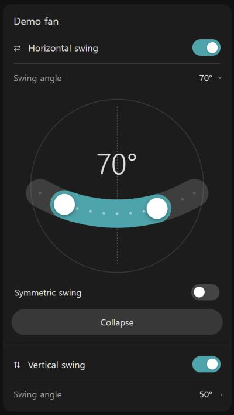
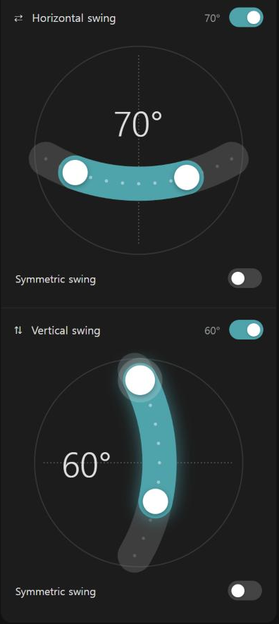

<h1 align="center">Fan Angle Card</h1>

<p align="center">
  Set a fan's oscillation range in Home Assistant with <b>one arc slider and two handles</b>,<br>
  the same way the Xiaomi Home app does.
</p>

<p align="center">
  <a href="https://github.com/StellarSea/ha-fan-angle-card/releases"></a>
  <a href="https://hacs.xyz/docs/faq/custom_repositories"></a>
  <a href="LICENSE"></a>
</p>

<p align="center">
  <b>English</b> · <a href="README.ko.md">한국어</a>
</p>

<p align="center">
  
  &nbsp;&nbsp;
  
</p>

---

## Contents

- [Why this card](#why-this-card)
- [Features](#features)
- [Installation](#installation)
- [Quick start](#quick-start)
- [Configuration](#configuration)
- [Using the card](#using-the-card)
- [How writes work](#how-writes-work)
- [Theming](#theming)
- [Troubleshooting](#troubleshooting)
- [Development](#development)

## Why this card

Some fan integrations expose the oscillation range as **separate boundary entities**. For example, `xiaomi_miot` exposes these four for the Xiaomi / Mijia circulators (`xiaomi.fan.p90`):

```
number.fan_left_angle    10–120
number.fan_right_angle    0–110
number.fan_up_angle      10–100
number.fan_down_angle     0–90
```

Editing two number sliders that depend on each other is awkward:

- You can't see the actual range, only two separate numbers.
- It's easy to pick an invalid pair, such as a left limit at or below the right limit.
- Many devices **silently ignore** a write that would make the range invalid. You change one value, nothing happens, and HA shows a state the device never had.

This card puts both limits of an axis on one arc and shows the total range in the middle. It only ever sends combinations the device accepts.

## Features

- 🎯 **Two-handle arc slider** per axis (horizontal and vertical), with the total angle shown in the middle
- 🧲 **Smooth dragging**: the handle follows your finger, snaps to the nearest step when you let go, and sends a single write
- 🛡️ **Safe writes**: keeps `high − low ≥ min_gap` and the entities' own `min` / `max` / `step`, and writes in an order where every in-between state is valid
- ↔️ **Drag the whole range** by grabbing its middle, or tap the track to jump the nearest handle there
- 🪞 **Symmetric mode**: the handles mirror around the center. It can be stored on the device through a switch.
- 🔘 Optional **swing on/off** toggle per axis
- ✨ Animations, glow, tick marks and haptic feedback, each of which can be turned off
- ⌨️ **Keyboard** control (arrow keys on a focused handle) and screen-reader labels
- 🧩 **Visual editor**: no YAML required
- 🌐 English and Korean UI, picked from your Home Assistant language

## Installation

### HACS (recommended)

[](https://my.home-assistant.io/redirect/hacs_repository/?owner=StellarSea&repository=ha-fan-angle-card&category=plugin)

Or add it by hand:

1. Open **HACS** (on Home Assistant 2026.11 and later: **Settings → Marketplace**).
2. Go to **⋮ → Custom repositories** and add `https://github.com/StellarSea/ha-fan-angle-card` with the category **Dashboard**.
3. Install **Fan Angle Card**. HACS registers the dashboard resource for you.
4. Reload the browser. In the companion app, clear the frontend cache.

### Manual

1. Download `fan-angle-card.js` from the [latest release](https://github.com/StellarSea/ha-fan-angle-card/releases/latest).
2. Copy it to `/config/www/`.
3. Go to **Settings → Dashboards → ⋮ → Resources → Add resource** and enter
   `/local/fan-angle-card.js?v=1.2.0`, type **JavaScript module**.
   Raise `?v=` whenever you update the file. Otherwise browsers keep the old copy for up to 31 days.
4. Hard-refresh the browser.

**Requirements:** Home Assistant 2024.11 or later, needed for the visual editor.

## Quick start

Add a card from the dashboard and search for **Fan Angle Card**. If a `number.*_left_angle` entity exists, the editor pre-fills the matching entities.

A minimal YAML configuration:

```yaml
type: custom:fan-angle-card
horizontal:
  left: number.fan_left_angle
  right: number.fan_right_angle
```

A full example for the Xiaomi P90 through `xiaomi_miot`:

```yaml
type: custom:fan-angle-card
title: Circulator
horizontal:
  left: number.xiaomi_p90_xxxx_left_angle
  right: number.xiaomi_p90_xxxx_right_angle
  swing: switch.xiaomi_p90_xxxx_horizontal_swing
  symmetric: switch.xiaomi_p90_xxxx_symmetrical_swing_h
vertical:
  up: number.xiaomi_p90_xxxx_up_angle
  down: number.xiaomi_p90_xxxx_down_angle
  swing: switch.xiaomi_p90_xxxx_vertical_swing
  symmetric: switch.xiaomi_p90_xxxx_symmetrical_swing_v
```

## Configuration

### How the entities map to the arc

Each axis needs two entities: one that holds the **larger** value and one that holds the **smaller** value.

| Axis | Larger value | Smaller value | Drawn as |
|---|---|---|---|
| `horizontal` | `left` | `right` | Larger values sit further **left**. On the P90, 0 = far right, 60 = front, 120 = far left. |
| `vertical` | `up` | `down` | Larger values sit further **up**. |

If your device works the other way round (for example, `right` holds the larger value), set `invert: true` on that axis.

The ends of the arc come from the entities' `min` and `max` attributes, and the snap step comes from `step`.

### Axis options

Use these under `horizontal:` and/or `vertical:`. Either axis can be left out.

| Option | Type | Default | Description |
|---|---|---|---|
| `left`, `right` / `up`, `down` | entity | **required** | The two boundary entities (`number` or `input_number`). |
| `swing` | entity | – | Switch that turns swinging on or off. Shown as a toggle in the axis header. |
| `symmetric` | entity | – | Switch that stores the symmetric mode on the device. Without it, the symmetric toggle only applies in the current browser. |
| `name` | string | localized | Axis title. |
| `icon` | icon | `mdi:arrow-left-right` / `mdi:arrow-up-down` | Axis icon. |
| `center` | number | middle of the range | Center that symmetric mode mirrors around. |
| `min_gap` | number | `2 × step` | Smallest allowed distance between the two limits. |
| `step` | number | entity `step` | Step that the handles snap to. |
| `invert` | boolean | `false` | Flip the direction of the axis. |
| `hide_symmetric` | boolean | `false` | Hide the symmetric toggle. |

### Card options

| Option | Type | Default | Description |
|---|---|---|---|
| `title` | string | – | Card title. |
| `always_open` | boolean | `false` | Always show the dials, with no "Swing angle" row or Collapse button. |
| `expanded` | boolean | `false` | Start with the dials open (collapsible layout only). |
| `hide_degree` | boolean | `false` | Hide the large angle number in the middle of the dial. |
| `hide_ticks` | boolean | `false` | Hide the step tick marks on the track. |
| `hide_glow` | boolean | `false` | Hide the glow shown while dragging. |
| `disable_animations` | boolean | `false` | Turn off easing and transitions. The system's *reduce motion* setting is also respected. |
| `disable_move` | boolean | `false` | Turn off moving the whole range by dragging its middle. |
| `disable_haptics` | boolean | `false` | Turn off haptic feedback in the companion app. |
| `skip_refresh` | boolean | `false` | Don't call `homeassistant.update_entity` before writing. See [How writes work](#how-writes-work). |

## Using the card

| Action | Result |
|---|---|
| Drag a handle | Moves that limit. The range never gets smaller than `min_gap`. |
| Drag the middle of the range | Moves the whole range and keeps its width. Not available in symmetric mode or with `disable_move`. |
| Tap the track | The nearest handle jumps to that spot. |
| Handles overlap | The direction you start dragging decides which handle moves. |
| Symmetric toggle | Turning it on snaps the range to the symmetric range closest to the current width. |
| Keyboard | Focus a handle with <kbd>Tab</kbd> and use the arrow keys. The value is sent 0.45 s after the last key press. |

Nothing is sent while you drag. The card writes once, when you let go.

## How writes work

When both limits change, the order matters. The card:

1. Asks Home Assistant to refresh both entities, because polled integrations can have a stale cache. Set `skip_refresh` to turn this off.
2. Picks an order that keeps the device valid after each write:
   - If the new high limit is at least `old low + min_gap`, it writes the **high limit first**.
   - Otherwise, if the new low limit is at most `old high − min_gap`, it writes the **low limit first**.
   - Starting from a valid state, one of the two always applies. If the current state is already invalid, the card fixes it first.
3. Shows the new values right away and fades the range gently until the entities report them. If they don't arrive within 8 seconds, the card goes back to the entity state.

Writes from the same card are queued, so a quick second drag waits for the first one to finish.

## Theming

Set any of these variables in your theme:

```yaml
my_theme:
  fan-angle-accent: "#4fa3ab"              # range and active switches
  fan-angle-track: "rgba(127,127,127,.35)" # unselected track
  fan-angle-handle: "#ffffff"              # handles
  fan-angle-switch-off: "rgba(127,127,127,.4)"
```

Text and divider colors follow your theme's `primary-text-color`, `secondary-text-color` and `divider-color`.

## Troubleshooting

<details>
<summary><b>The card says "Custom element doesn't exist" or shows an old version</b></summary>

Check that the resource is registered (**Settings → Dashboards → ⋮ → Resources**) and is of type *JavaScript module*. Then hard-refresh the browser (<kbd>Ctrl</kbd>+<kbd>Shift</kbd>+<kbd>R</kbd>). In the companion app, use **Reset frontend cache** in the app's settings.
</details>

<details>
<summary><b>A value jumps back after I set it</b></summary>

The device probably rejected the combination. Check the valid range on the device or in its app, and set `min_gap` (and `step` if needed) to match. For example, the P90 needs at least 20° between its left and right limits.
</details>

<details>
<summary><b>The handles show the wrong side</b></summary>

Your device stores the larger value in the other entity. Set `invert: true` on that axis.
</details>

<details>
<summary><b>Symmetric mode turns itself off after a reload</b></summary>

Without a `symmetric` entity, the mode only lasts in the current browser. Point `symmetric` at the device's symmetric-swing switch if it has one.
</details>

## Development

The whole card is one dependency-free file: [`fan-angle-card.js`](fan-angle-card.js).

[`test.html`](test.html) is a playground. It uses a mocked `hass` object and a fake device that ignores invalid writes, the way the P90 does:

```bash
python -m http.server 8765
# open http://localhost:8765/test.html  (add ?lang=en for English)
```

Tested with the Xiaomi P90 (`xiaomi.fan.p90`) through the [`xiaomi_miot`](https://github.com/al-one/hass-xiaomi-miot) integration. The card should work with any device that exposes its range as two boundary `number` entities. Issues and PRs are welcome.

## License

[MIT](LICENSE)
